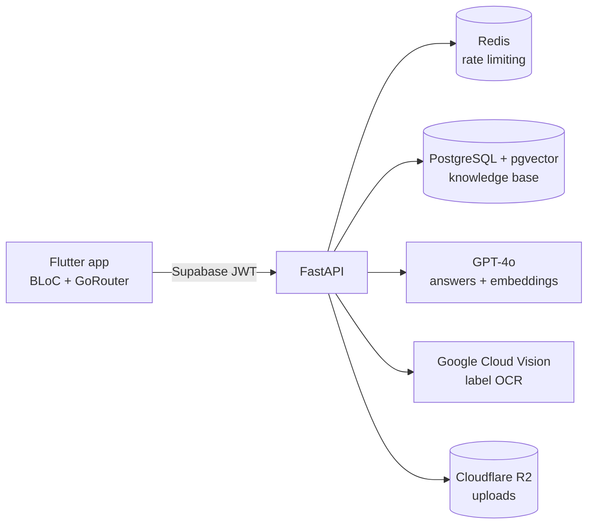

# Miaoyi 妙医

Miaoyi is an AI-powered mobile health information assistant that explains Traditional Chinese Medicine (TCM) and modern medicine side by side. Users ask questions in English or Chinese, or photograph a medicine or ingredient label, and get plain-language answers grounded in a curated knowledge base, with numbered source citations.

> **Medical disclaimer:** Miaoyi provides general information only. It does not diagnose, treat or replace advice from a doctor or pharmacist.

## Architecture



**Question flow:** the app sends the question to `POST /v1/chat`. The API verifies the Supabase JWT, applies a per-user rate limit in Redis, embeds the question, retrieves the closest chunks from pgvector (cosine similarity), and asks GPT-4o to answer using only that context and to cite it as `[1]`, `[2]`. If nothing relevant is found, the API says so instead of guessing.

**Label scan flow:** `POST /v1/scan` receives a photo, extracts its text with Google Cloud Vision, stores the image in Cloudflare R2, and explains the text through the same retrieval pipeline.

## Safety design
- Answers are restricted to retrieved context, with citations and an "I don't have reliable information" fallback
- The system prompt forbids diagnosis and any advice to start, stop or change medicines
- Emergency keywords in English and Chinese add a prompt to contact emergency services
- Persistent disclaimer banner in the app
- JWT verification, upload type and size limits, and per-user rate limiting

## Tech stack
| Layer | Technology |
|---|---|
| Mobile | Flutter, flutter_bloc, go_router |
| API | FastAPI, Pydantic, psycopg (async pool) |
| AI | GPT-4o, OpenAI embeddings, Google Cloud Vision |
| Data | PostgreSQL with pgvector (HNSW index), Redis, Cloudflare R2 |
| Auth | Supabase (JWT verified in the API) |
| DevOps | Docker Compose, GitHub Actions, Codemagic (APK builds) |

## Run the backend
```bash
cp .env.example .env          # add your keys
docker compose up --build -d
docker compose run --rm api python -m scripts.ingest data/knowledge   # load the knowledge base
curl localhost:8000/health
```
Interactive API docs are at `http://localhost:8000/docs`. Put your own reviewed articles in `backend/data/knowledge/` as markdown files (a `# Title` line, an optional `source:` line, then the text) and re-run the ingest command.

## Run the tests
```bash
cd backend && pip install -r requirements.txt && pytest -q
```

## Run the mobile app
```bash
cd mobile
flutter create . --project-name miaoyi --platforms=android,ios   # generates platform folders
flutter pub get
flutter run --dart-define=API_BASE_URL=http://10.0.2.2:8000 --dart-define=DEV_TOKEN=<supabase access token>
```
`10.0.2.2` is the host machine as seen from the Android emulator. For production, replace the dev token with the session token from Supabase sign-in in `lib/main.dart`.

## Project structure
```
backend/
  app/            FastAPI app: auth, rate limit, RAG, vision, storage, routers
  db/init.sql     pgvector schema and index
  scripts/        knowledge-base ingestion
  tests/          pytest suite (RAG prompt, safety, auth)
mobile/lib/       api client, chat (BLoC), scan, router
.github/          CI: backend tests + Docker build, Flutter analyze
codemagic.yaml    Android APK build
```

## Roadmap
- Supabase sign-in screens and conversation history
- Chinese and English knowledge base with source reviews
- Evaluation set for answer faithfulness and citation accuracy
- Streaming responses

## License
MIT. See [LICENSE](LICENSE).
